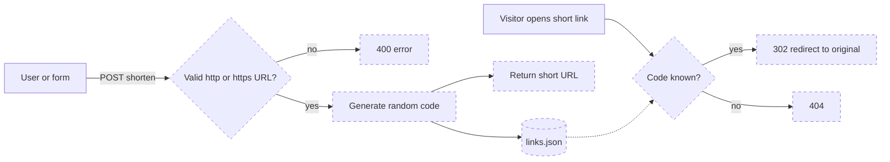

## Summary

Adds a simple URL shortener that needs nothing installed: a single Node file with a web form, a JSON API to shorten a link, and redirects from short codes. Links are saved to a local JSON file so they survive a restart. It is built for a single process and light use.

## Flow

## How to review

1. {{file:server.js:29}} — `isValidUrl` decides which links are accepted. Check that only `http`/`https` gets through.
2. {{file:server.js:21}} — `newCode` picks a random 6-character code and retries on a collision. Check that the code length and alphabet are fine for URLs.
3. {{file:server.js:76}} — the shorten endpoint reads the body (capped at 10 KB), validates it, saves it and returns the short URL. Note that `shortUrl` is built from the request's `Host` header.
4. {{file:server.js:100}} — the redirect lookup. Check the 302 status and the 404 fallback.
5. {{file:server.js:10}} — links load at startup and the whole file is rewritten on each save. Consider whether that's acceptable for the expected use.

## Decisions

Each decision below is also an inline comment on the code it affected. Reply on the thread to discuss; run `/pr-kit:address-review` to pull replies back into the authoring session.

{{decisions}}

## Testing

Tested by hand with curl on a local port: shortening returned a code, the code redirected (302) to the original URL, a `javascript:` URL was rejected with 400, and an unknown code returned 404. There are no automated tests, and the browser form was not tested by hand.
